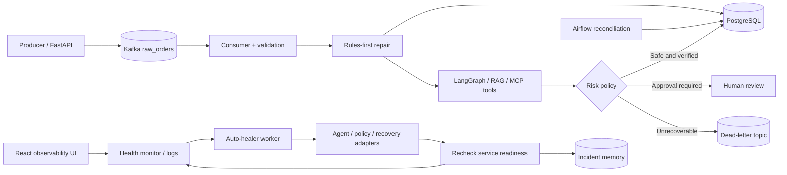

# AI-Powered Self-Healing Data Pipeline

A production-style reliability lab for streaming data pipelines. The platform combines **FastAPI, React, Kafka, PostgreSQL, Redis, Apache Airflow, Docker, LangGraph, RAG incident memory and MCP-style operational tools** to demonstrate record repair, stage monitoring, safe automated recovery, human approval and recovery observability.

> **Project status:** Portfolio/research demo, not a hardened production deployment. Recovery actions can affect local Docker services; use in an isolated development environment.

## What it does

- **Ingestion and data repair:** Validates Kafka events, applies deterministic rules, optionally reasons about harder problems with an LLM, persists valid records, and routes unrecoverable events to the DLQ.
- **Infrastructure recovery:** Monitors Docker-backed services, detects stopped consumers and unavailable dependencies, invokes an allowlisted recovery action and verifies the result.
- **Safe autonomy:** A background auto-healer monitors the system; the recovery policy/agent selects allowed actions; risky operations require human review.
- **AI operations:** Incident memory / RAG, traces, tool-call evaluation, semantic caching, cost summaries and an agent activity timeline.
- **Control room:** React pages for the live pipeline map, background console, approvals, incidents, replay, metrics and AI engineering.

## Architecture



See [System architecture](docs/ARCHITECTURE.md), [Recovery workflow](docs/RECOVERY.md), and [Local setup](docs/SETUP.md).

## Run locally

The application source and Compose configuration should be checked out in the repository root. Prerequisites: Docker Desktop with Compose, and Python and Node.js for running development tests.

```bash
cp .env.example .env
# Edit .env: set credentials and keep recovery disabled initially.
docker compose up -d --build
docker compose ps
./scripts/create_topics.sh
```

Then open the React dashboard at **http://localhost:3000**, FastAPI documentation at **http://localhost:8000/docs**, Airflow at **http://localhost:8080**, and Prometheus at **http://localhost:9090** if those services are enabled.

**Security:** Do not commit `.env`, API keys, credentials, personal data, or local databases. The Docker socket gives its holder highly privileged access to the Docker host. Only enable Docker-backed recovery for a trusted local demo.

## Demo: recover a stopped consumer

```bash
docker compose stop consumer
docker compose logs -f auto-healer
docker compose ps consumer
curl http://localhost:8000/pipeline/health
```

With automatic safe recovery enabled and working, the monitor detects the stopped consumer, the recovery layer restarts it, verifies health, records the outcome, and displays an incident timeline. This sequence is a **test to run**, not a guarantee that it will pass on every machine.

## Validation

```bash
PYTHONPATH=. pytest -q tests
cd frontend && npm ci && npm test -- --run && npm run build
```

Measure recovery success and latency from actual test runs; avoid publishing unmeasured throughput claims. See [Testing](docs/TESTING.md).

## Repository structure

```text
src/              Python pipeline, APIs, agents, recovery logic
frontend/         React observability application
dags/             Airflow reconciliation DAGs
db/               PostgreSQL schema
mcp_server/       Operational tools
observability/    Prometheus / Grafana configuration
scripts/          Demo, load and benchmarking utilities
tests/            Python tests
docs/             Architecture, recovery and testing guides
docker-compose.yml
```

## Known limitations

- Automated restarts use Docker-specific adapters in the local demo and are not a replacement for cluster orchestration.
- Service running does not by itself prove readiness or successful end-to-end processing.
- Model-assisted decisions and memory usefulness require measured evaluations and end-to-end traces.
- Production readiness requires RBAC, alert delivery, durable audit data, secrets management, SLOs and real chaos/load measurements.

## License

Add a license before redistributing or reusing this repository beyond GitHub's default terms.
