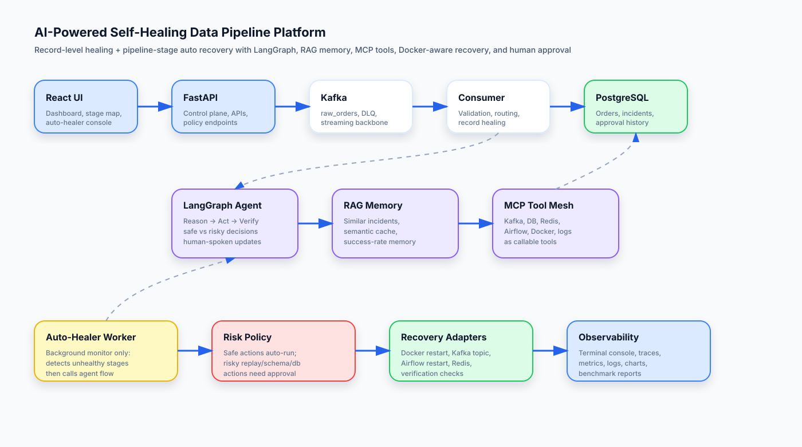
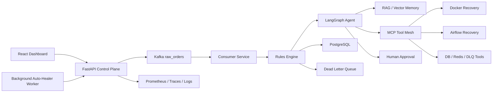

# Short Architecture Diagram

## Mermaid view

## Separation of responsibilities

- **Auto-healer worker:** detects unhealthy stages and triggers the recovery endpoint.
- **Agent decision layer:** decides safe vs risky recovery using policy, memory, and tool context.
- **Recovery adapters:** execute Docker/Kafka/Airflow actions.
- **Verifier:** reruns health checks before marking recovered.
- **Memory:** stores outcomes for future recovery decisions.
